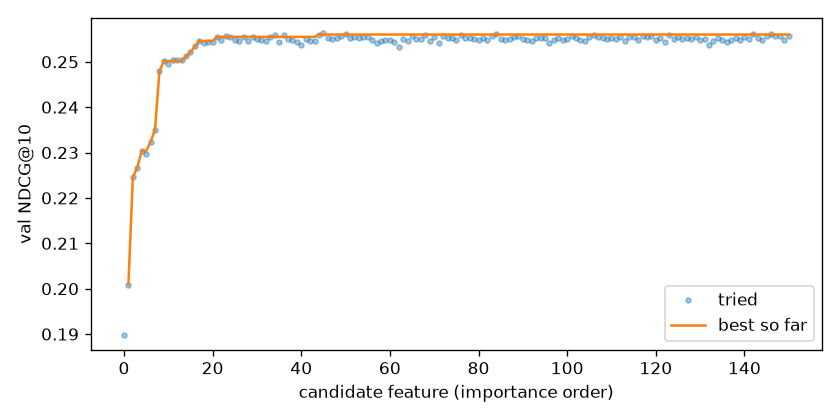
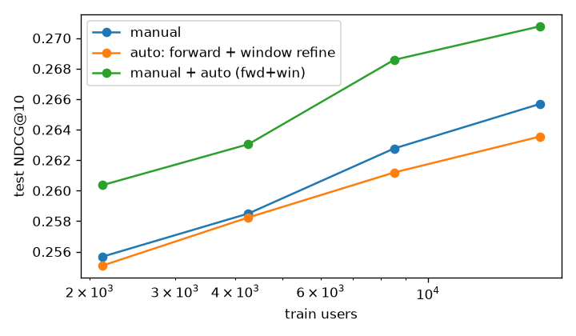

# Ручные признаки против автоматической генерации на Yambda-500M

Тестовое задание: построить ранжирующий пайплайн с градиентным бустингом на ручных признаках без утечек и сравнить его с автоматическим построением и отбором признаков.

**Короткий итог.** На тесте (45 940 пользователей, 11.6 млн пар user–item):

| | NDCG@10 | Recall@100 | признаков |
|---|---|---|---|
| лучшая эвристика (повторы) | 0.1861 | 0.3148 | – |
| LightGBM, только скоры кандидатов | 0.1966 | 0.3175 | 7 |
| **LightGBM + ручные признаки** | **0.2657** | 0.3486 | 7 + 41 |
| LightGBM + авто (forward-отбор) | 0.2635 | 0.3445 | 7 + 14 |
| LightGBM + авто (top-41 по важности) | 0.2684 | 0.3471 | 7 + 41 |
| LightGBM + авто (все 232 после скрининга) | 0.2688 | 0.3478 | 7 + 232 |
| **LightGBM + ручные ∪ авто** | **0.2708** | **0.3497** | 7 + 54 |

- Автоматический поиск по пространству из 1 236 признаков (только train и val) почти без участия человека выходит на уровень ручного набора. Широкие авто-наборы его немного обходят: top-41 по важности на +0.0027 NDCG@10, все 232 после скрининга на +0.0031 (95% ДИ выше нуля). Компактный forward-отбор (14 признаков вместо 41) немного уступает: −0.0021, ДИ [−0.0034; −0.0013].
- Лучше всего работает объединение ручного набора и найденных автоматически признаков: +0.0051 NDCG@10 (+1.9%), ДИ [+0.0043; +0.0058]. Перевес держится на val и на всех размерах обучающей выборки.
- Знаки этих разниц устойчивы: в трёх прогонах с разными выборками train/val-пользователей объединение даёт +0.0044…+0.0057, широкие авто-наборы +0.0014…+0.0031, forward-отбор −0.0007…−0.0021 (раздел 5). Но разброс между прогонами (~0.001) сопоставим с шириной ДИ, поэтому сами величины разниц порядка 0.001–0.003 надо читать с этой поправкой.
- Почти вся польза сосредоточена в прямых user×item признаках (повторное прослушивание). Поиск сам пришёл к этому выводу, ручные абляции его подтверждают.

---

## 1. Данные и постановка

**Датасет**: [Yambda-500M](https://huggingface.co/datasets/yandex/yambda), `flat/500m/multi_event.parquet`: 100 000 пользователей, 3.0 млн треков, 480 млн событий (listen, like, dislike, unlike, undislike). У событий есть флаг `is_organic`, доля прослушивания `played_ratio_pct`, а у треков категориальные признаки артист и альбом (`artist_item_mapping`, `album_item_mapping`). Пользователей **не сэмплировал**: все признаки и кандидаты строятся по полной истории всех 100k пользователей. Подвыборки пользователей берутся только для строк обучения и валидации ранкера.

**Задача**: ранжирование треков на следующий день. Пара (user, track) получает метку 1, если в окне метки у пользователя был *listen+* этого трека (прослушано ≥ 50%, как в статье Yambda). Повторные прослушивания тоже считаются позитивом: это естественный сценарий для музыки («что пользователь будет слушать завтра»).

**Разбиение по времени** (секунды; границы test и val совпадают с официальным бенчмарком Yambda, `LAST = 26 000 000`, gap = 30 минут):

```
 история ... | gap | train-день | gap | val-день | gap | test-день ]
                                                               LAST
```

| split | окно метки | история для признаков | пользователи |
|---|---|---|---|
| train | 1 день перед val | `ts < start − 30 мин` | 20 000 случайных с ≥1 позитивом (все позитивы + 30 случайных негативов) |
| val | `[LAST−2d−gap, LAST−1d−gap)` | `ts < start − 30 мин` | 5 000 случайных с ≥1 позитивом, все кандидаты |
| test | `[LAST−1d, LAST]` | `ts < start − 30 мин` | **все** 45 940 с ≥1 позитивом, все кандидаты |

**Почему нет утечек.**
1. Все признаки, кандидаты и глобальные статистики (популярность, co-occurrence) для сплита считаются функцией `history()` с фильтром `ts < cutoff`. Каждая загрузка истории проверяется assert'ом `check_no_leak` в [splits.py](src/splits.py).
2. Метки берутся только из `[start, end)`, и это окно не пересекается с историей того же сплита. `check_layout()` проверяет порядок: train-метки < val-cutoff, val-метки < test-cutoff.
3. Подбор признаков (скрининг, важности, forward-отбор, окна) и гиперпараметров идёт только на train и val. Тест считается один раз, после того как все наборы зафиксированы.
4. Все модели используют одних и тех же кандидатов, одни и те же строки и одни и те же базовые колонки. Ручной и авто-наборы описаны на одном языке признаков ([autofe/dsl.py](src/autofe/dsl.py)), поэтому им доступна одинаковая информация.

## 2. Кандидаты (общие для всех моделей)

[candidates.py](src/candidates.py): объединение четырёх источников, в среднем 253 кандидата на пользователя.

| источник | что это | кандидатов (test) | доля позитивов |
|---|---|---|---|
| `rep` | listen+ пользователя за 30 дней, топ-100 по частоте и свежести | 4.19 млн | 6.5% |
| `i2i` | соседи по совместному прослушиванию (окно 7 дней, лаг ≤ 3, косинус) от 30 последних треков | 4.52 млн | 2.0% |
| `art` | топ-20 популярных треков 5 любимых артистов | 2.71 млн | 3.5% |
| `pop` | топ-30 по listen+ за последние сутки | 1.38 млн | 1.7% |

**Recall кандидатов = 28.1%**. Это потолок для всех ранкеров: в среднем у пользователя 27 разных listen+-треков в день, и большая часть из них новые для него. Метрики ниже считаются по **всем** позитивам пользователя, а не только по попавшим в кандидаты, поэтому Recall@100 ≤ 0.28 + запас за счёт min(n_pos, k).

Ранги и скоры источников (`rep_rank, rep_cnt, i2i_score, i2i_rank, art_rank, pop_rank, n_src`) входят во **все** модели как базовые колонки.

## 3. Ручной бейзлайн

[features_manual.py](src/features_manual.py): 41 признак, как их написал бы инженер рекомендательной системы.
- **user** (8): активность за 7 и 30 дней, доля дослушиваний, скипов, лайков, органики, число уникальных треков, давность последнего прослушивания.
- **item** (11): популярность за 1, 7 и 30 дней, тренд 7d/30d, дослушиваемость, скип-рейт, лайк- и дизлайк-рейт, охват по пользователям, средний `played_ratio`, «возраст» трека.
- **user×item, прямые** (10): прослушивания и listen+ за 7d, 30d и всё время, скипы, давность последнего прослушивания, listen+, лайка и дизлайка, средняя доля прослушивания.
- **user×artist / user×album, косвенные** (10): listen+, доля артиста в прослушиваниях пользователя за 7 и 30 дней, скип-рейт по артисту, лайки, давность, число разных треков артиста.
- **artist** (2): популярность и тренд.

Модель: LightGBM `lambdarank` (NDCG@10, truncation 30), early stopping по val. Небольшая сетка `num_leaves × min_data_in_leaf` (6 точек) подобрана по val на ручном наборе и затем применяется **ко всем** наборам одинаково. Выбраны `num_leaves=63, min_data_in_leaf=50`. Для LogLoss и ROC-AUC отдельно обучается `binary`-модель с теми же признаками. Её вероятности поправлены на даунсэмплинг негативов (`p/(p+(1−p)/r)`, r = 0.122).

## 4. Автоматическая генерация и отбор признаков

### Пространство признаков (DSL)
Признак — это «SQL-запрос» к логу событий, заданный пятью осями:

```
key   ∈ {u, i, artist, album, u×i, u×artist, u×album}       # GROUP BY / JOIN
event ∈ {listen, listen+, skip<30%, organic, reco, like, dislike, unlike}  # WHERE
window∈ {6h, 1d, 3d, 7d, 14d, 30d, 90d, all}                 # WHERE ts >= cutoff − w
agg   ∈ {count, mean played_ratio, n_unique, time since last, time since first}
derived: rate (event₁/event₂, т.е. конверсии), share (u×X / u — доля связи в активности пользователя),
         trend (count_w1/w1 ÷ count_w2/w2)
```

Пример: `ua.share.listen.7d` — доля прослушиваний пользователя за неделю, ушедших артисту этого трека. Всего получается **1 236 признаков**. Ручной набор — это 41 точка того же пространства.

**Масштабирование вычислений.** Пользователи разбиты на 16 бакетов по диапазонам uid, в каждом бакете лежит полная история его пользователей. Признаки по ключам u, ui, ua, ual считаются локально внутри бакета. Признаки item, artist и album считаются как *частичные агрегаты* (sum, max, min, а n_unique по пользователям аддитивен, потому что пользователи в бакетах не пересекаются) и складываются по бакетам. Поэтому все 1 236 признаков над 480 млн событий считаются за ~3.7 минуты на сплит при пике памяти 9 ГБ на одной машине (20 ядер, 32 ГБ).

### Отбор ([autofe/select.py](src/autofe/select.py))
1. **Скрининг**: выкидываются пустые (>99% null) и константные признаки, остальные ранжируются по |AUC−0.5| в двух вариантах: глобально и *внутри пользователя* (признак центрируется по uid, так что видно его ранжирующую силу). Берутся топ-300, затем удаляются дубликаты с |ρ Спирмена| > 0.95. Осталось **1236 → 232** признака.
2. **Важность**: один LightGBM-ранкер на всех 232 признаках, порядок по gain.
3. **Жадный forward-отбор** (wrapper): признаки перебираются в порядке важности (150 штук). Признак принимается, если val NDCG@10 растёт больше чем на 5·10⁻⁴. Бюджет B = 41 (как у ручного набора) не был достигнут: принято **14 признаков**.
4. **Уточнение окон**: для каждого выбранного признака пробуются соседние окна (7d → 3d/14d и т.п.). Принято две замены: `ui.share.lplus.all → 90d` (val +0.0005) и `ui.cnt.listen.7d → 3d` (val +0.0007); на тесте обе вместе дают +0.0004. То есть сдвиг окна на соседнее значение сетки меняет качество на 10⁻⁴…10⁻³ NDCG, что меньше разброса между прогонами (раздел 5). На вопрос «почему 7, а не 10 дней» это отвечает лишь частично: окна берутся из фиксированной сетки (6h, 1d, 3d, 7d, 14d, 30d, 90d, all), уточнение проверяет только соседей по ней, и 10 дней ни разу не пробовались. Строго вывод такой: соседние окна сетки почти взаимозаменяемы. Поиск по произвольной длине окна (например, 5–20 дней с шагом в день) — возможное продолжение.

Затраты на весь поиск: 168 обучений LightGBM в wrapper и одна модель для важности, **~8 минут** (скрининг 53 с, важность 8 с, wrapper 427 с).

Выбранные признаки после уточнения окон (13 из 14 — прямые user×item):
`ui.since_last.lplus, ui.share.lplus.7d, ui.rate.lplus/listen.90d, ui.cnt.lplus.7d, ui.share.lplus.90d, ui.share.lplus.14d, ui.since_first.like, ui.cnt.listen.3d, ui.cnt.org.14d, ui.share.like.90d, ui.share.lplus.3d, ui.rate.skip/listen.all, ui.share.listen.14d, ua.nuniq.lplus.30d`



## 5. Результаты (test)

Полная таблица, все модели на одних и тех же 11.6 млн строках:

| модель | признаков | NDCG@10 | NDCG@100 | Recall@10 | Recall@100 | ROC-AUC | LogLoss | val NDCG@10 |
|---|---|---|---|---|---|---|---|---|
| heur: popularity 1d | – | 0.0260 | 0.0969 | 0.0275 | 0.2047 | | | |
| heur: item2item | – | 0.0579 | 0.0773 | 0.0610 | 0.1194 | | | |
| heur: rep > i2i > artist > pop | – | 0.1749 | 0.2247 | 0.1796 | 0.3159 | | | |
| heur: repeat | – | 0.1861 | 0.2294 | 0.1872 | 0.3148 | | | |
| GBDT: candidate scores only | 0 | 0.1966 | 0.2356 | 0.1960 | 0.3175 | 0.8145 | 0.1104 | 0.1892 |
| **GBDT: manual** | 41 | 0.2657 | 0.2834 | 0.2595 | 0.3486 | 0.8893 | 0.0976 | 0.2596 |
| GBDT: auto top-B by importance | 41 | 0.2684 | 0.2844 | 0.2622 | 0.3471 | 0.8862 | 0.0979 | 0.2607 |
| GBDT: auto forward | 14 | 0.2631 | 0.2811 | 0.2572 | 0.3448 | 0.8798 | 0.0993 | 0.2554 |
| GBDT: auto forward + window refine | 14 | 0.2635 | 0.2812 | 0.2576 | 0.3445 | 0.8801 | 0.0992 | 0.2580 |
| GBDT: auto all screened | 232 | 0.2688 | 0.2849 | 0.2627 | 0.3478 | 0.8876 | 0.0976 | 0.2619 |
| **GBDT: manual ∪ auto** | 54 | **0.2708** | **0.2865** | **0.2642** | **0.3497** | **0.8928** | **0.0967** | 0.2635 |

Значимость (парный bootstrap по пользователям, 200 повторов, разница NDCG@10 с ручным набором):

| модель | Δ NDCG@10 | 95% ДИ |
|---|---|---|
| auto forward + window refine (14) | −0.0021 | [−0.0034; −0.0013] |
| auto top-41 by importance | +0.0027 | [+0.0015; +0.0035] |
| auto all screened (232) | +0.0031 | [+0.0020; +0.0039] |
| manual ∪ auto (54) | **+0.0051** | [+0.0043; +0.0058] |

Эти интервалы учитывают только то, какие пользователи попали в тест. Модели обучены один раз с одним seed LightGBM, и разброс от обучения в интервалы не входит.

**Разброс между прогонами.** Пайплайн прогонялся полностью три раза. В первых двух прогонах выборка train/val-пользователей зависела от порядка строк после `group_by`, поэтому в них попали разные пользователи (в первом ещё и artist/album кандидатов брались из истории бакета, а не из справочника треков). Итоговый третий прогон детерминирован. Тестовые пользователи и кандидаты во всех трёх прогонах одни и те же, так что разница между прогонами показывает, насколько выводы зависят от выборки train/val-пользователей и от того, что на ней выберет поиск.

| Δ NDCG@10 к manual | прогон 1 | прогон 2 | прогон 3 (итоговый) |
|---|---|---|---|
| auto forward (+window refine) | −0.0007 | −0.0014 | −0.0021 |
| auto top-41 by importance | +0.0018 | +0.0014 | +0.0027 |
| auto all screened | +0.0031 | +0.0025 | +0.0031 |
| manual ∪ auto | +0.0057 | +0.0044 | +0.0051 |

Знаки устойчивы во всех трёх прогонах, но сами разницы гуляют на ~0.001, примерно как ширина bootstrap-ДИ. Поэтому надёжные выводы такие: объединение лучше ручного набора примерно на 0.005; широкие авто-наборы лучше на 0.001–0.003; компактный forward-отбор немного хуже. Разброс от seed LightGBM при фиксированных данных отдельно не оценивался.

### Абляция ручного набора

| убрали группу | NDCG@10 | Δ |
|---|---|---|
| — (manual) | 0.2657 | |
| user-item (прямые) | 0.2408 | **−0.0249** |
| user | 0.2601 | −0.0056 |
| user-artist/album (косвенные) | 0.2639 | −0.0018 |
| item | 0.2645 | −0.0012 |
| artist | 0.2657 | 0.0000 |

### Масштабируемость по объёму обучения



| train users | manual | auto forward | manual ∪ auto |
|---|---|---|---|
| 2 127 | 0.2557 | 0.2551 | 0.2604 |
| 4 255 | 0.2585 | 0.2582 | 0.2630 |
| 8 511 | 0.2628 | 0.2612 | 0.2686 |
| 17 022 | 0.2657 | 0.2635 | 0.2708 |

### Вычислительные затраты

| этап | время | пик RAM |
|---|---|---|
| бакетирование 480 млн событий | 19 с | – |
| кандидаты (3 сплита) | 87 с | 8 ГБ |
| **все 1 236 признаков**, train + val | 440 с | 9 ГБ |
| **авто-отбор** (169 обучений) | 509 с | 17.8 ГБ |
| test: 41 ручной признак, 11.6 млн строк | 22 с | |
| test: 264 признака (все наборы), 11.6 млн строк | 53 с | |
| обучение ранкера: manual / auto-14 / union / 232 | 9 / 4 / 6 / 15 с | |

Чтобы обслуживать найденную модель, считать все 1 236 признаков не нужно: только 14 (или 54) выбранных, это дешевле ручного набора. Дорогая часть поиска одноразовая и укладывается примерно в 15 минут на одной машине.

## 6. Анализ

**Что сработало.**
- *Повторное потребление решает всё.* Без прямых user×item признаков ручная модель теряет 0.025 NDCG@10, а без любой другой группы — не больше 0.006. Авто-отбор независимо пришёл к тому же: 13 из 14 признаков относятся к группе `ui`.
- *Поиск находит формы признаков, которые человек не написал.* Ключевая находка — **share-признаки** `ui.share.*`: доля трека в прослушиваниях пользователя за окно, то есть счётчик, нормированный на активность пользователя. В ручном наборе были абсолютные счётчики `ui.cnt.*`, а нормировка делалась только для артиста. Ещё несколько: `ui.since_first.like` (как давно трек в «лайкнутых»), `ui.rate.lplus/listen.90d` и `ui.rate.skip/listen.all` (насколько этот пользователь обычно дослушивает или пропускает этот трек), `ui.cnt.org.14d` (сколько раз пользователь включал трек сам, а не из рекомендаций), набор окон 3d/7d/14d/90d вместо одного «7 дней». В объединённой модели по gain-важности первые три места занимают share-признаки (`ui.share.lplus.90d`, `ui.share.lplus.7d`, `ui.share.lplus.14d`), выше всех ручных признаков, то есть именно они дают прирост над ручным набором.
- *Ручные признаки не лишние.* Объединение лучше обоих наборов по отдельности, выигрыш устойчив на всех размерах обучения. Авто-отбор оказался хорошим генератором дополнений к экспертному набору, а не только его заменой.

**Что не сработало и ограничения.**
- *Forward-отбор консервативен и шумит.* Пороговое правило отклонило user- и item-признаки, которые по абляции дают около 0.005–0.006. Вероятная причина: по отдельности каждый из них даёт меньше eps (и меньше шума между запусками), а заметный вклад появляется только у группы целиком. Поэтому 14-признаковый набор хуже ручного, а широкие наборы (top-41, все 232) — лучше. От выборки train/val-пользователей forward-отбор зависит сильнее всего: в трёх прогонах он брал 18, 16 и 14 признаков, а разница с ручным набором менялась от −0.0007 до −0.0021. Лучше было бы добавлять признаки блоками по (key, kind) или ослабить eps с поправкой на шум.
- *Уточнение окон дало мало.* Две принятые замены добавили +0.0004 NDCG@10 на тесте, в двух прошлых прогонах замен не было вовсе. Соседние окна сильно коррелированы, и бустинг легко компенсирует неоптимальное окно соседними признаками. Выбор между соседними окнами сетки (3d/7d/14d) на этих данных почти не влияет на качество. Промежуточные окна вроде 10 дней не проверялись; раз 7d и 14d взаимозаменяемы, большого эффекта от них ждать не стоит, но это предположение, а не измерение.
- *Шум сопоставим с маленькими эффектами.* Разброс от выборки train/val-пользователей (~0.001 NDCG@10 по трём прогонам) того же порядка, что разницы между авто-наборами и ручным. Разброс от seed LightGBM отдельно не оценивался; для точных величин эффектов стоит усреднить несколько seed'ов и выборок.
- *Потолок задают кандидаты* (recall 28%). Около 70% завтрашних listen+ — треки, которых нет среди 253 кандидатов, и ни один ранкер их не достанет. Улучшение генерации кандидатов (например, двухбашенная модель или audio-эмбеддинги из `embeddings.parquet`) — следующий по важности шаг, но он вне темы задания.
- Одно train-окно (1 день). Больше окон дало бы больше данных, но кривая масштабирования показывает, что рост уже замедляется (+0.002–0.003 при удвоении 8.5k → 17k).
- Val используется и для отбора, и для early stopping, поэтому val-метрики авто-наборов слегка оптимистичны. Итоговые выводы сделаны только по тесту.
- LogLoss и AUC получены от отдельной `binary`-модели на даунсэмплированных негативах, вероятности скорректированы на prior. Относительный порядок моделей совпадает с ранжирующими метриками.

**Замечание про официальный бенчмарк.** В `benchmarks/yambda/evaluation/metrics.py` NDCG считается так: `ideal_dcg = calc_dcg(target_mask)`. Это DCG *предсказанной* маски, поэтому метрика вырождается. Здесь метрики написаны заново ([metrics.py](src/metrics.py)), IDCG считается по min(n_pos, k) позитивам пользователя.

## 7. Воспроизведение

### Данные

Нужны три файла из [yandex/yambda](https://huggingface.co/datasets/yandex/yambda), всего ~3.7 ГБ: `flat/500m/multi_event.parquet` (3.6 ГБ), `artist_item_mapping.parquet` и `album_item_mapping.parquet`. Код ищет их в HF-кэше рядом с папкой репозитория (`../hub/datasets--yandex--yambda/snapshots/<revision>/`, путь задан в [config.py](src/config.py)). Склонировать репозиторий и скачать именно эту ревизию в этот кэш:

```bash
pip install -U huggingface_hub
git clone https://github.com/Sev23456/Tbank_sci.git
cd Tbank_sci
hf download yandex/yambda --repo-type dataset --revision dd6f3a19eef5866e346c3270e098baa641a44948 --cache-dir ../hub flat/500m/multi_event.parquet artist_item_mapping.parquet album_item_mapping.parquet
```

Если файлы уже лежат в другом месте, достаточно поменять `RAW` в [config.py](src/config.py). Ревизия зафиксирована, чтобы границы сплитов (`LAST = 26 000 000`) совпадали с данными.

### Запуск

```bash
python -m venv .venv && .venv/Scripts/pip install -r requirements.txt   # Linux/macOS: .venv/bin/pip
cd src
python prepare.py           # 480 млн событий -> 16 бакетов (data/events), ~20 с
python run_all.py           # все этапы: cands, feats, select, test_feats, final, scaling (~55 мин)
python make_report.py       # таблицы results/report_tables.md и графики results/fig/
```

`python run_all.py --smoke` прогоняет то же самое на 2 бакетах за ~6 минут (нужен готовый `data/events` от `prepare.py`). Смоук-прогон по умолчанию пишет в `data_smoke/` и `results_smoke/` и не трогает результаты полного прогона; отчёт по нему: `python make_report.py --smoke`. Папки можно переопределить переменными `EXP_DATA` и `EXP_RESULTS`. Отдельный этап запускается так: `--stage final` (предыдущие этапы закэшированы на диске). Прогон детерминирован: seed фиксирован, выборка пользователей не зависит от порядка строк, ничьи в рангах кандидатов разбиваются по id, LightGBM работает в `deterministic=True`. Два независимых построения кандидатов дают одинаковые таблицы. Путь к датасету задан в [config.py](src/config.py) (HF-кэш `../hub/datasets--yandex--yambda`).

| файл | содержимое |
|---|---|
| [src/prepare.py](src/prepare.py) | бакетирование по пользователям, присоединение артиста и альбома |
| [src/splits.py](src/splits.py) | временные окна, метки, проверки утечек |
| [src/candidates.py](src/candidates.py) | 4 источника кандидатов |
| [src/autofe/dsl.py](src/autofe/dsl.py) | язык признаков, генерация пространства, частичные агрегаты |
| [src/features.py](src/features.py) | расчёт произвольного списка признаков для сплита |
| [src/features_manual.py](src/features_manual.py) | ручной набор |
| [src/autofe/select.py](src/autofe/select.py) | скрининг, важность, forward-отбор, уточнение окон |
| [src/train.py](src/train.py), [src/metrics.py](src/metrics.py) | LightGBM и метрики |
| [src/run_all.py](src/run_all.py) | весь эксперимент |
| `results/` | `test_metrics.csv`, `selection.json`, `bootstrap.json`, `scaling.csv`, `timings.json`, `importance_*.csv`, `run_full.log` |
